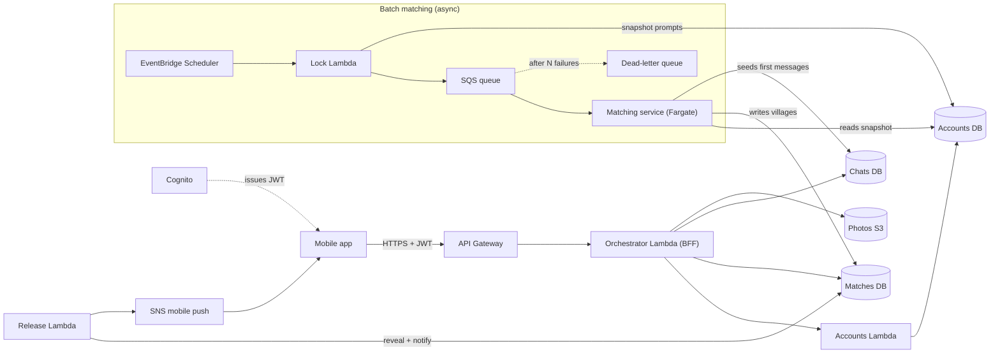
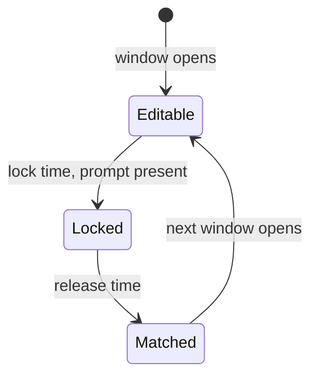
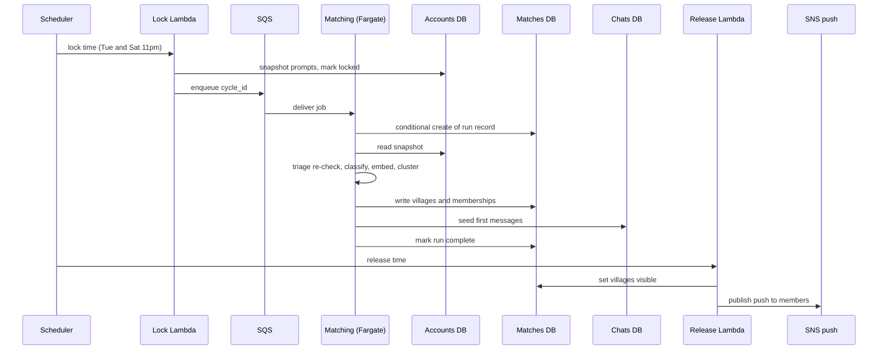

# Village — Architecture Design (v0.1 — Draft)

Companion to `my-village-PRD.md`. Built from the PRD, the two architecture sketches, and decisions made along the way.
It supersedes `my-village-architecture-diagram.png` where the two disagree (corrections noted in §6 and §10).

**Status tags used throughout**

| Tag | Meaning |
|---|---|
| **[D] Decided** | Came from your sketches or the PRD, or you confirmed it |
| **[P] Proposed** | My recommendation. Applies unless you push back |
| **[?] Open** | Needs your call. Collected in §17 |

---

## 1. Context and goals

Village matches mothers into small topic-based villages (5–10 people) twice a week, seeds each village with every member's own prompt, and lets them chat. Matching is by shared current experience, not profile traits (PRD §1, §3).

**What the architecture has to do well**

- Run a **twice-weekly batch** (Sun and Wed) that clusters thousands of free-text prompts into villages, reliably and exactly once per cycle.
- Treat a **sensitive prompt** (parenting struggles, sometimes mental-health adjacent) with care: safety triage, privacy, moderation.
- Serve a **low-traffic, bursty** app cheaply: spikes at match time, quiet otherwise.
- Be **demo-able and honest** as a portfolio piece: runs end to end, with the parts that are mocked clearly labeled.

**Non-goals for MVP** (PRD §4): location-based matching, Pinboard, multi-child profiles, real-time chat *at scale*.

---

## 2. Design principles

1. **Serverless-first, containers where the job needs them.** Lambda for request/response, Fargate for the long batch job. [P]
2. **Async for heavy work.** The user-facing API never waits on matching. [D]
3. **Server-authoritative time and state.** Lock times, cycle state and message order come from the server clock, never the client. [P]
4. **Idempotent everywhere.** Every retry (SQS redelivery, client resend, Scheduler double-fire) must be safe. [P]
5. **Infrastructure as code, no click-ops.** One repo reproduces the whole stack. [P]
6. **Least privilege and privacy by design.** Collect the minimum, encrypt everything, one IAM role per function. [P]
7. **Observable from day one.** Structured logs, metrics and traces tied to the PRD's success metrics. [P]

---

## 3. System overview



### Components

| Component | Tech | Responsibility | Tag |
|---|---|---|---|
| Mobile app | React Native with Expo (TypeScript) | UI; polls for new chat messages | [D] |
| API Gateway | HTTP API with JWT authorizer | Single front door, throttling | [P] |
| Orchestrator | Lambda | The BFF the app talks to. Serves home, villages, chat. Calls Accounts, reads Matches and Chats directly | [D] |
| Accounts API | Lambda | Profile and current prompt (read and PATCH), safety triage at submit | [D] |
| Accounts DB | DynamoDB | Profiles, prompts, mentor opt-ins | [D] |
| Matches DB | DynamoDB | Villages, memberships, run ledger | [D] |
| Chats DB | DynamoDB | Messages | [D] |
| Scheduler | EventBridge Scheduler | Fires lock and release events on a timezone-aware cron | [D] |
| Lock Lambda | Lambda | Freezes the cycle's prompts, enqueues the job | [P] |
| Queue | SQS plus DLQ | Decouples trigger from work, retries | [D] |
| Matching service | Fargate task | Classify, embed, cluster, write villages | [D] |
| Release Lambda | Lambda | Reveals villages at a chosen time and sends the push | [P] |
| Push | SNS mobile push (APNs and FCM) | "New village!" notifications | [D] |
| Identity | Cognito user pool | Sign-up, login, JWTs | [P] |
| Photos | S3 plus CloudFront | Profile photos via presigned upload | [P] |

**Note on the "cache" box in your first sketch:** dropped. The current prompt lives on the profile record; a TTL cache solves a read-latency problem this app doesn't have. [D]

---

## 4. The cycle engine

The product's heartbeat (PRD §12.1). Everything in the app is derived from "where is this user in the cycle".

| Track | Window opens | Locks | Match released |
|---|---|---|---|
| Wed match | Mon morning | Tue 11pm | Wed |
| Sun match | Thu morning | Sat 11pm | Sun |



- A user with **no prompt at lock time stays Editable** and rolls to the next lock (PRD missed-window rule). [D]
- `cycle_id` is the match date plus track, for example `2026-10-14#WED`. Every prompt, run and village carries one. [P]
- The API computes state from the schedule and the server clock (`GET /home` returns `state`, `lock_at`, `next_match_at`). The client only renders it. A PATCH after lock returns `409`, even if the app's clock is wrong. [P]
- **Timezone:** one canonical timezone for lock and release, set in Scheduler. See §17 Q6. [?]
- **Release is separate from compute.** Matching can run right after lock; villages stay hidden (`visible_at` in the future) until the Release Lambda fires. That keeps the push at a civilized hour and makes "everyone gets matches at the same time" true by construction. [P]

---

## 5. Core flows

### 5.1 Submit or edit a prompt (sync)

1. App calls `PATCH /v1/me/prompt` with text and kind (struggle or milestone).
2. Accounts Lambda rejects with `409` if the cycle is locked.
3. **Safety triage runs synchronously** (§9.3). If flagged, the response carries `triage` and resource links; the app shows the interstitial.
4. The prompt is saved on the user's record for the open `cycle_id`. Later edits overwrite it until lock.

Classification and embedding are **not** done here. They happen once, at the snapshot step, so edits are free and the result always reflects the final text. [P]

### 5.2 Batch matching (async)



### 5.3 Read villages and chat (sync)

- `GET /v1/villages`: the "My Villages" list (name, logo, unread, "new" flag). Only villages with `visible_at <= now`.
- `GET /v1/villages/{id}/preview`: topic and member count only. **This is the Soft Preview screen** and the endpoint missing from the earlier sketch.
- `POST /v1/villages/{id}/enter`: marks joined. The user lands in the live chat.
- `GET /v1/villages/{id}/messages` and `POST .../messages`: chat (§10).

### 5.4 Mentor loop (async, months later)

1. When a user marks a struggle resolved and opts in, store a `MENTOR_OPTIN` item (topic, child age band at the time, resolved date). Without this the topic is forgotten months later.
2. After clustering, a mentor-selection step picks up to N opted-in mentors per village (matching category, older age band, at most one invite per mentor per cycle).
3. The invite appears as the Home "Mentor Invite" state. Accepting adds her to the village with `role = mentor`. Declining keeps her eligible (PRD §11). [P]

---

## 6. Data model

Three DynamoDB tables, one per bounded context, matching your sketch. Chat grows fastest and has a different retention and encryption profile, so it stays separate. On-demand capacity. [D]

**Correction to the earlier diagram:** it said "query Matches DB where `member_ids` contains `user_id`". DynamoDB can't do that efficiently (it would be a scan). Membership is stored as its own items, with a reverse index. [P]

### Accounts table

| PK | SK | Notes |
|---|---|---|
| `USER#id` | `PROFILE` | bio, photo keys, gender, child birth month (see §17 Q9), push token, notification prefs |
| `USER#id` | `PROMPT#cycle_id` | text, kind, status (open, locked), category and subcategory (set at snapshot), safety flag, timestamps |
| `USER#id` | `MENTOR_OPTIN#id` | topic, age band, resolved date, status |

### Matches table

| PK | SK | Notes |
|---|---|---|
| `VILLAGE#id` | `META` | topic, life-stage band, cycle_id, size, visible_at, status |
| `VILLAGE#id` | `MEMBER#user_id` | role (member or mentor), entered_at, last_read message id, seed prompt snapshot |
| `CYCLE#cycle_id` | `RUN` | status, counts, start and finish times. Doubles as the idempotency lock for the job |

**GSI1** (inverted: SK as partition key, PK as sort key) answers "all villages for this user". The village id is derived deterministically from the cycle and sorted member ids, so a retried run cannot create duplicates.

### Chats table

| PK | SK | Notes |
|---|---|---|
| `VILLAGE#id` | `MSG#ulid` | sender id, body, kind (seed, user, system), client_msg_id. ULIDs sort by time and are unique |

**Access patterns**

| Need | Query |
|---|---|
| Home screen | Get `PROFILE` plus the open `PROMPT#cycle_id` |
| My villages | GSI1 on `USER#id` |
| Village preview | Get `VILLAGE#id / META` |
| Open a chat | Query `MSG#` newest first, limit 50, paginate by `before` |
| New messages since X | Query `MSG#` with sort key greater than X |
| Unread count | Compare `last_read` to the latest message id |

---

## 7. API surface

Maps to your sketch (`/home`, `/village-overview`, `/village-details/{id}`). Versioned, resource-style names proposed. [P]

| Your sketch | Proposed | Purpose |
|---|---|---|
| `/home` | `GET /v1/home` | Profile summary, prompt and state, new-match banner, mentor invite |
| PATCH Accounts | `PATCH /v1/me/prompt` | Edit the prompt (`409` after lock) |
| `/village-overview` | `GET /v1/villages` | My Villages list |
| (missing) | `GET /v1/villages/{id}/preview` | Soft Preview |
| (missing) | `POST /v1/villages/{id}/enter` | Join after preview |
| `/village-details/{id}` | `GET /v1/villages/{id}` | Village info and members |
| (chat) | `GET` / `POST /v1/villages/{id}/messages` | Read and send. POST takes `client_msg_id` for idempotency |
| (mentor) | `POST /v1/villages/{id}/resolve`, `POST /v1/mentor-invites/{id}/respond` | Opt-in and invite response |
| (push) | `PUT /v1/me/devices` | Register push token |
| (safety) | `POST /v1/messages/{id}/report`, `POST /v1/users/{id}/block` | Minimum moderation surface |

The **OpenAPI spec is the contract**. Client types and request validation are generated from it. [P]

Open: should the prompt PATCH debounce on the client (explicit save versus autosave)? See §17 Q10.

---

## 8. Matching and classification pipeline

Runs in the Fargate task. Inputs: the frozen snapshot for one `cycle_id`.

1. **Safety re-check.** Re-run triage on each snapshotted prompt (the submit-time check may have failed open). Flagged prompts follow the PRD path: resources first, still eligible to be placed.
2. **Classify.** Map free text to category and subcategory from the PRD §10 taxonomy using an LLM with structured (JSON schema) output. Server-side only; the confirmation screen is cut. [D for server-side, ? for model, see §17 Q4]
3. **Embed.** One text embedding per prompt.
4. **Pool.** Group by category, then by life-stage band (widen to plus or minus one band when a pool is thin, per PRD §10).
5. **Cluster.** Inside each pool, cluster by embedding similarity under a **size constraint of 5–10**. Split large pools into parallel villages; merge or carry over small ones.
6. **Mentor step.** See §5.4.
7. **Write.** Villages, memberships and seed messages in transactional batches.

**Edge cases that need a decision** (§17): what happens to users in pools too small to reach minimum size; whether seed messages post at match time or when she enters.

**Determinism and safety nets**

- Run record uses a conditional write (`NOT_STARTED` to `RUNNING`) so a double-fired trigger does nothing.
- Deterministic village ids and conditional puts make retries safe.
- Each run logs: pool sizes, village size distribution, unmatched count, mean intra-village similarity, model latency and cost.
- **Offline eval:** a small hand-labeled set of prompts checks classifier accuracy before any model change ships. Removing the user-facing confirmation removes the human feedback loop, so this is how misclassification gets caught (PRD §10 trade-off).

---

## 9. Security, privacy and safety

### 9.1 Identity and access
- Cognito user pool; API Gateway JWT authorizer on every route except health. [P]
- If third-party sign-in is offered on iOS, Sign in with Apple must be offered too (App Store rule). Verify current guideline when building.
- Every Lambda and the Fargate task get their own least-privilege IAM role. No shared admin roles.
- Authorization is by membership: a user can only read a village's messages if a `MEMBER#` item exists for her.

### 9.2 Data protection
- TLS everywhere; encryption at rest with a customer-managed KMS key for Accounts and Chats. [P]
- Secrets in Secrets Manager or SSM Parameter Store, never in env files or the repo.
- **Photos:** private bucket, presigned uploads, size and type limits, **strip EXIF (location) on upload**, serve via CloudFront. Consider automated image moderation.
- **Minimize collection.** Store child *birth month and year* only, never the child's name or photo. No third-party analytics SDK that receives prompt text.
- Retention policy and an **account deletion flow**: remove profile and photos, replace her messages' sender with "Former member". [P]

### 9.3 Safety triage (PRD §5.1, §9 step 4, Risk #7)
- Two gates: synchronous at submit (fast, may fail open) and again at snapshot (authoritative).
- Store only the flag and timestamp, not the model's reasoning. Restrict who can read flags.
- If the classifier errors, **never block the user**; queue for re-check.
- The interstitial's wording and what it promises is a **legal question, not an engineering one**. Not resolved here (PRD Risk #7).
- Out of scope for MVP, but a known gap: crisis language *inside* chat messages. Mitigation for now is report/block plus the "peer experience, not medical advice" notice (PRD Risk #3).
- Consumer health-data laws (for example Washington's My Health My Data Act) may apply to prompts of this kind. Needs real counsel. I'm not a lawyer.

### 9.4 Abuse
- Rate limits per user on chat and prompt endpoints (API Gateway throttling plus a per-user counter).
- Report and block from the first release. Peanut's moderation complaints are in PRD §1; shipping without it would repeat them.

---

## 10. Chat: storage and delivery

**Storage** is settled: one DynamoDB item per message (§6). **Delivery** is the open choice.

| Option | What it is | Effort | Feels live? |
|---|---|---|---|
| Polling | App re-fetches `messages?after=<last id>` every few seconds, and on app focus | None | A few seconds behind |
| AppSync Events | Managed serverless WebSocket pub/sub. Publish to a channel per village after the write. No GraphQL schema needed | Low–medium | Instant |
| Pusher or Ably | Hosted pub/sub with an SDK | Low | Instant |
| Chat-as-a-service (Stream, Sendbird) | They store the messages too | Low | Instant, but data leaves your DB |

Recommended pattern whichever you pick: **write to DynamoDB first (source of truth), then publish.** On reconnect the client always fetches "after last seen id" so nothing is lost if a push is missed. [P]

**Correction to the earlier comparison:** I described AppSync as requiring a GraphQL schema. That's true for classic AppSync; AppSync Events is a simpler pub/sub product. Verify current limits and pricing before choosing.

**Decided: polling for MVP, with the publish step behind an interface** so a real-time provider can be added later without touching storage. PRD §4 already allows mocked real-time. [D]

---

## 11. Push notifications

- SNS mobile push to APNs and FCM; device tokens registered via `PUT /v1/me/devices`. [D for SNS direction, P for specifics]
- **Do not use Amazon Pinpoint.** I mentioned it earlier as an option; as far as I know AWS is retiring it, with end of support announced for late October 2026. Verify against AWS's current notice. SNS mobile push or AWS End User Messaging are the alternatives.
- Triggered by the Release Lambda at release time, not by the matching job, so timing is controlled. Copy follows PRD §12.5 (playful tone).
- Handle dead tokens: remove a token when delivery reports it invalid.
- Respect user notification preferences (Settings screen content still open in the PRD).

---

## 12. Reliability

- **Queue:** SQS with a dead-letter queue after N receives, and a visibility timeout longer than the longest expected run. Alarm on DLQ depth above zero.
- **Idempotency:** run ledger (§8), deterministic village ids, `client_msg_id` on chat POSTs, Lambda Powertools idempotency on write endpoints.
- **Failure mode if matching fails:** users stay in "Locked" with a delayed-matches banner; the job retries; an on-call alarm fires. No partial reveal, because villages are hidden until release.
- **Optional upgrade:** replace Lock, SQS and Fargate wiring with an **AWS Step Functions** workflow (snapshot, match, verify, release). You get built-in retries, per-step state and a visual execution history, which is also a strong portfolio artifact. Costs a little more complexity. See §17 Q8.

---

## 13. Observability

- **Logs:** structured JSON with a correlation id from API Gateway through to the DB write (Lambda Powertools logger).
- **Traces:** X-Ray or OpenTelemetry across the request path and the batch job.
- **Metrics and alarms:** matching run duration, villages created, village-size distribution, unmatched rate, push delivery rate, API p95 latency, 5xx rate, DLQ depth.
- **Product metrics** (PRD §7): "reply within 48 hours" and "village active past first cycle" are derivable from message timestamps. Emit domain events (`PromptSubmitted`, `VillageCreated`, `MessagePosted`) to an EventBridge bus so analytics never has to read production tables. Stretch goal. [P]
- A budget alarm on the AWS account from day one.

---

## 14. Delivery and operations

**Repo layout (monorepo)**

```
village/
├── apps/mobile/            # React Native + Expo (TypeScript)
├── services/
│   ├── orchestrator/       # BFF Lambda (Python)
│   ├── accounts/           # Accounts Lambda (Python)
│   └── matching/           # Fargate job, Python container
├── packages/api-spec/      # OpenAPI contract, generated types
├── infra/                  # IaC (see §17 Q3)
├── tools/simulator/        # synthetic cohort generator
└── docs/                   # PRD, architecture, wireframes
```

- **Languages:** Python for all backend code, TypeScript for the mobile app. Because the two sides share no code, the **OpenAPI spec is the single source of truth**: generate the TypeScript client from it and validate Python requests and responses against it (for example with Pydantic models kept in sync with the spec). Use AWS Lambda Powertools for Python for logging, metrics, tracing and idempotency. [P]
- **CI/CD:** GitHub Actions. PR checks: lint, tests, IaC plan or synth. Deploy on merge. Authenticate to AWS with **OIDC role assumption, not long-lived access keys**. Separate dev and prod accounts or at least stacks. [P]
- **Testing:** unit tests; contract tests against the OpenAPI spec; DynamoDB-local integration tests; the **matching simulator**.
- **Simulator:** generates realistic synthetic prompts and cohorts so you can tune matching and check size distribution and unmatched rate with zero real users. It validates the *algorithm*, not whether mothers engage; the group-size spike in PRD §5.5 still needs real people.
- **Demo posture:** the live app has few users. The simulator plus clearly labeled seeded demo data is the honest way to show the loop working. Don't present synthetic villages as real ones.

---

## 15. Cost envelope

At demo scale this should sit comfortably inside AWS free-tier and on-demand pricing: Lambda and DynamoDB are pay-per-use, the Fargate task runs minutes per cycle (about eight runs a month), and the LLM calls are per prompt, so tiny. I haven't priced it; validate with the AWS Pricing Calculator and keep the budget alarm in §13. The cost that can surprise you is the model: log tokens per run and cap them.

---

## 16. What changes at scale (not MVP)

- Shard matching by pool (category by age band) and run pools in parallel (Step Functions Map state).
- Move accounts and matches to Postgres with pgvector if cross-user queries or similarity search outgrow in-memory clustering.
- Fan-out pushes in batches or via topics; move chat delivery to a managed real-time layer.
- Add a read cache only when metrics show a read-latency problem.

---

## 17. Decisions log and open questions

### Decided

| # | Decision |
|---|---|
| D1 | Serverless AWS: Lambda for APIs, Fargate for batch |
| D2 | Three data stores (Accounts, Matches, Chats), per your sketch |
| D3 | No cache; prompt lives on the profile record |
| D4 | EventBridge Scheduler to SQS to Fargate for matching |
| D5 | Classification is server-side only; confirmation screen cut |
| D6 | Auto-placement with a Soft Preview, no accept/deny |
| D7 | One chat message per DynamoDB item, newest-first reads |
| D8 | Push via SNS, not Pinpoint |
| D9 | Mobile client: React Native with Expo |
| D10 | Chat delivery: polling for MVP, publish step behind an interface (upgrade later) |
| D11 | Backend language: Python (Lambdas and the Fargate matching job) |

### Open (with my default if unanswered)

| # | Question | Default |
|---|---|---|
| Q1, Q2 | *Answered: see D9 and D10* | n/a |
| Q3 | IaC tool, now that the backend is Python: AWS CDK in Python (one language across services and infra), or Terraform (HCL, more portable, common in job postings)? | CDK in Python |
| Q4 | Matching engine: managed LLM and embeddings through Bedrock, another provider, or rules and TF-IDF for MVP? **Pending your research.** Questions to answer: classification quality on paraphrases, cost per run, data leaving AWS or not, latency, and what you can explain in an interview | Bedrock (provisional) |
| Q5 | Auth: Cognito, or a hosted provider (Clerk/Auth0)? | Cognito |
| Q6 | Lock and release timezone: one canonical zone (Eastern?), and what release hour? | Eastern, release at 8am |
| Q7 | Seed message: posted at match time, or when she taps Enter? | At match time (matches "auto-placed") |
| Q8 | Orchestration: your SQS plus Fargate wiring, or Step Functions? | Your SQS wiring for MVP |
| Q9 | Store child's age as entered, or birth month so the life-stage band stays correct over time? | Birth month |
| Q10 | Prompt edit: explicit save, or autosave with debounce? | Explicit "Find my village" / save |
| Q11 | Users in pools too small to form a village: carry over, lower the minimum size early on, or fold into a broader village? | Carry over to next cycle with priority |
| Q12 | Mentor invites: how many mentors per village, and who can they see? | Up to 2 per village |
| Q13 | Village "logo" in the My Villages list: generated from topic, or chosen? | Generated from topic |
| Q14 | Photos on profile: automated image moderation in MVP or post-MVP? | Post-MVP, with report and block |

---

*Next steps: answer the open questions above, then produce the OpenAPI spec and IaC skeleton, and stand up the simulator. The PRD still has its own open items (Settings content, profile confirmation copy, Mentor Invite design, safety-screen legal review).*
